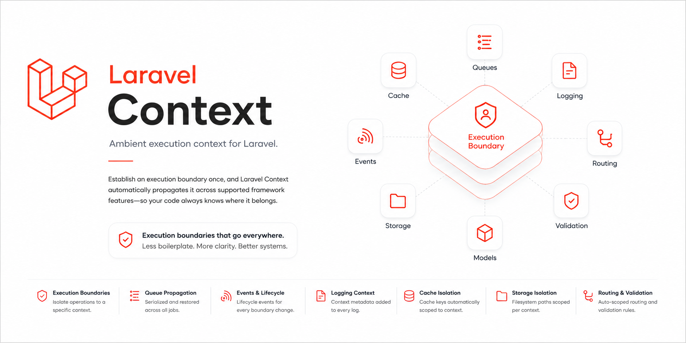

<p align="center">
    
</p>

# Laravel Context

[](https://packagist.org/packages/zaber-dev/laravel-context)
[](https://github.com/zaber-dev/laravel-context/actions/workflows/run-tests.yml)
[](https://packagist.org/packages/zaber-dev/laravel-context)
[](https://packagist.org/packages/zaber-dev/laravel-context)
[](https://packagist.org/packages/zaber-dev/laravel-context)

**Supports:** Laravel 11, 12 & 13+ • PHP 8.2+ • Memory • Extensible

**Ambient execution context and tenant boundary engine for Laravel.**

Promote execution boundaries into a first-class application primitive. Seamlessly propagate tenant, workspace, or project context across background queues, cache stores, storage disks, loggers, route model bindings, validation rules, and Eloquent models — without passing context objects down every call stack.

> **Context is an environment concern, not a parameter concern.** Every SaaS application has context (a Tenant, Workspace, or Organization). Passing context parameters manually across controllers, jobs, cache keys, storage paths, and validation rules leads to leaky abstractions and security risks.

---

## Quick Example

```php
use ZaberDev\Context\Facades\Context;
use App\Models\Workspace;
use App\Jobs\GenerateReport;

// 1. Establish an execution boundary
Context::execute($workspace, function () {
    
    // Auto-prefixed cache keys: "workspaces:12:stats"
    Cache::context()->remember('stats', 3600, fn () => fetchStats());

    // Auto-isolated storage paths: "workspaces/12/reports/summary.pdf"
    Storage::disk('public')->context()->put('reports/summary.pdf', $pdfData);

    // Auto-injected log metadata: [App\Models\Workspace:12] with Correlation UUID
    Log::info('Generating workspace report');

    // Auto-serializes boundary state into queued jobs and restores it when executed!
    GenerateReport::dispatch();

    // Auto-assigns context foreign keys and scopes queries automatically!
    Task::create(['title' => 'Prepare Quarterly Audit']);
});
```

---

## The Power of Propagation

```text
                 Execution Boundary (e.g. Workspace)
                                 │
     ┌───────────────────────────┼───────────────────────────┐
     ▼                           ▼                           ▼
Cache Isolation           Queue Propagation          Storage Scoping
("workspaces:12:...")   (Serialized Job Payload)   ("workspaces/12/...")
                                 │
                                 ▼
                          Background Worker
                                 │
                 ┌───────────────┴───────────────┐
                 ▼                               ▼
            Log Telemetry                  Eloquent Scopes
        (Correlation UUIDs)              (WHERE context_id = ?)
```

---

## Common Use Cases

Laravel Context is ideal for:

- **Multi-Tenant SaaS Applications**: Isolate database queries, cache entries, storage uploads, and queues by Tenant or Workspace.
- **Distributed Microservices & Tracing**: Propagate UUID `boundaryId` Correlation IDs across distributed logs and queue workers.
- **Asynchronous Workflows**: Capture active context boundaries (`Context::capture()`) and execute closures safely in background threads or pipelines.
- **Context-Aware Validation**: Enforce unique database constraints scoped strictly to the current tenant using `Rule::contextUnique()`.
- **Automatic Route Binding**: Bind route parameters (`/workspaces/{workspace}/projects`) directly into the active context stack using route macros.

---

## Why not Polymorphic Relations or Global Scopes?

Polymorphic relations and Eloquent global scopes are designed purely for database querying. They do not propagate boundaries across queues, caches, storage disks, loggers, or validation rules.

| Feature | Polymorphic Relations | Global Scopes | Laravel Context |
| :--- | :---: | :---: | :---: |
| **Primary Purpose** | Eloquent relationships | Database query filtering | **Ambient Execution Boundaries** |
| **Queue Propagation** | ❌ Manual parameter passing | ❌ None | ✅ **Automatic Payload Serialization & Restoration** |
| **Cache Key Isolation** | ❌ Manual key formatting | ❌ None | ✅ **`Cache::context()->remember()`** |
| **Storage Disk Isolation** | ❌ Manual path prefixing | ❌ None | ✅ **`Storage::disk()->context()->put()`** |
| **Log Telemetry Injection** | ❌ Manual `Log::withContext()` | ❌ None | ✅ **Automatic Model Metadata & Correlation UUID** |
| **Route Model Auto-Binding** | ⚠️ Manual Controllers | ⚠️ Manual Middleware | ✅ **`Route::context('workspace')`** |
| **Validation Rule Scoping** | ⚠️ Manual Query Constraints | ⚠️ Manual Filters | ✅ **`Rule::contextUnique()` & `Rule::contextExists()`** |
| **Closure Snapshot Capture** | ❌ None | ❌ None | ✅ **`Context::capture(fn() => ...)`** |
| **Transactional Boundaries** | ❌ None | ❌ None | ✅ **`Context::transaction($model, fn() => ...)`** |
| **Extensible Driver Architecture**| ❌ Hardcoded | ❌ Custom Classes | ✅ **`Context::extend()` Manager Support** |

---

## Features

- **Ambient Execution Boundaries** ⭐: Establish boundary stacks with `Context::execute($model, fn())` or `Context::push($model)`.
- **Automatic Queue Propagation** ⭐: Serializes context state into dispatched queue jobs and restores the exact boundary stack when workers process the job.
- **Context-Aware Cache & Storage**: Access scoped drivers cleanly via `Cache::context()` and `Storage::disk()->context()`.
- **Correlation ID Tracing**: Generates a unique UUID `boundaryId` for every execution boundary, injecting tracing telemetry into application loggers.
- **Context-Aware Eloquent Scopes**: Attach the `IsContextual` trait to models for automatic foreign key assignment and query scoping.
- **Validation Rule Macros**: Simplify tenant-aware form validation with `Rule::contextUnique()` and `Rule::contextExists()`.
- **Async Closure Snapshots**: Capture active boundary snapshots using `Context::capture()` for safe execution inside background threads or event handlers.
- **Contextual Transactions**: Execute context boundaries wrapped automatically inside database transactions (`Context::transaction()`).

---

## Documentation

- [Installation](#installation)
- [Configuration](#configuration)
- [Usage Guide](#usage-guide)
- [LEARN.md](LEARN.md)

---

## Installation

Install the package via Composer:

```bash
composer require zaber-dev/laravel-context
```

Publish the configuration file:

```bash
php artisan vendor:publish --provider="ZaberDev\Context\ContextServiceProvider"
```

---

## Configuration

The configuration file `config/context.php` defines default drivers and integration behaviors:

```php
return [
    /*
    |--------------------------------------------------------------------------
    | Default Context Driver
    |--------------------------------------------------------------------------
    */
    'driver' => 'memory',

    /*
    |--------------------------------------------------------------------------
    | Automatically Registered Integrations
    |--------------------------------------------------------------------------
    */
    'integrations' => [
        'queue'   => true,
        'cache'   => true,
        'log'     => true,
        'storage' => true,
    ],
];
```

---

## Usage Guide

### 1. Ambient Execution Boundaries

Wrap operations inside an execution boundary using `Context::execute()`:

```php
use ZaberDev\Context\Facades\Context;
use App\Models\Tenant;

$tenant = Tenant::find(1);

Context::execute($tenant, function () {
    // All supported framework features automatically inherit $tenant!
    echo Context::current()->name;
});
```

You can also push and pop boundaries manually on the context stack:

```php
Context::push($organization);
Context::push($workspace);

// Retrieve active context details
$info = Context::info();
$info->current;    // Workspace
$info->parent;     // Organization
$info->root;       // Organization
$info->boundaryId; // Unique UUID correlation ID

Context::pop(); // Pops workspace, leaves organization active
```

---

### 2. Context-Aware Queues & Propagation

When dispatching jobs inside an active execution boundary, Laravel Context automatically serializes the boundary stack into the queue job payload.

```php
Context::execute($workspace, function () {
    // Job dispatches with serialized Workspace context
    ProcessSubscriptionRenewal::dispatch();
});
```

When the queue worker picks up `ProcessSubscriptionRenewal`, the job middleware automatically restores the boundary before `handle()` runs, popping it cleanly when finished!

---

### 3. Context-Aware Cache & Storage

Scope cache keys and filesystem paths automatically without manual string concatenations:

```php
Context::execute($workspace, function () {

    // Scopes cache key to "workspaces:12:user_count"
    Cache::context()->remember('user_count', 3600, fn () => User::count());

    // Scopes path to "workspaces/12/avatars/user_1.png"
    Storage::disk('s3')->context()->put('avatars/user_1.png', $fileData);
});
```

---

### 4. Correlation IDs & Log Telemetry

Every execution boundary generates a unique UUID `boundaryId`. Laravel Context automatically injects context model details and correlation IDs into `Log::withContext()`:

```php
Context::execute($workspace, function () {
    Log::info('Updating payment status');
});
```

Produces log entries enriched with context metadata:

```json
{
    "message": "Updating payment status",
    "context": {
        "context_type": "App\\Models\\Workspace",
        "context_id": 12,
        "boundary_id": "9b1deb4d-3b7d-4bad-9bdd-2b0d7b3dcb6d"
    }
}
```

---

### 5. Capturing Closures & Snapshot Restoration

Capture an active execution boundary snapshot to safely pass callbacks into asynchronous pipelines:

```php
// Capture closure bound to the active Workspace context
$callback = Context::capture(function () {
    // Executes inside the captured boundary regardless of when or where invoked!
    Log::info('Deferred execution');
});

// Execute later in a different execution thread
$callback();
```

Or manually capture and restore context snapshots:

```php
$snapshot = Context::snapshot();

// ... later
Context::restore($snapshot);
```

---

### 6. Context Resolvers & Route Binding

Teach Laravel how to resolve context dynamically when no explicit boundary is set:

```php
use ZaberDev\Context\Resolvers\RequestResolver;

// Register dynamic resolver in AppServiceProvider
Context::resolver(function () {
    return auth()->user()?->currentWorkspace;
});

// Or resolve from HTTP Route parameters
Context::resolver(new RequestResolver(request(), 'workspace'));
```

Bind route parameters automatically using route macros:

```php
use Illuminate\Support\Facades\Route;

Route::get('/workspaces/{workspace}/dashboard', [DashboardController::class, 'show'])
    ->context('workspace');
```

---

### 7. Validation Rule Macros

Scope database validation rules strictly to the active execution context:

```php
use Illuminate\Validation\Rule;

$request->validate([
    // Ensures slug is unique strictly within the current Context boundary
    'slug' => ['required', Rule::contextUnique('projects', 'slug')],

    // Ensures category_id exists strictly within the current Context boundary
    'category_id' => ['required', Rule::contextExists('categories', 'id')],
]);
```

---

### 8. Context-Aware Eloquent Models

Attach `IsContextual` trait to Eloquent models for automatic foreign key population and query scoping:

```php
namespace App\Models;

use Illuminate\Database\Eloquent\Model;
use ZaberDev\Context\Traits\IsContextual;

class Project extends Model
{
    use IsContextual;
}
```

Inside an active context boundary:

```php
Context::execute($workspace, function () {

    // Automatically populates context_id = 12 and context_type = 'App\Models\Workspace'
    $project = Project::create(['name' => 'New Redesign']);

    // Automatically appends: WHERE context_id = 12 AND context_type = 'App\Models\Workspace'
    $projects = Project::all();
});
```

---

### 9. Contextual Database Transactions

Atomically execute boundaries inside database transactions:

```php
Context::transaction($workspace, function () {
    // Executes inside DB::transaction() while maintaining Workspace context
    Order::create([...]);
    Inventory::decrement(...);
});
```

---

### 10. Extending Custom Context Drivers

Register custom drivers using Laravel's Manager pattern via `Context::extend()`:

```php
use ZaberDev\Context\Facades\Context;

Context::extend('redis', function ($app) {
    return new RedisContextDriver($app['redis.connection']);
});
```

---

## Testing

Run the test suite using PHPUnit:

```bash
composer test
```

---

## License

The MIT License (MIT). Please see [License File](LICENSE.md) for more information.
